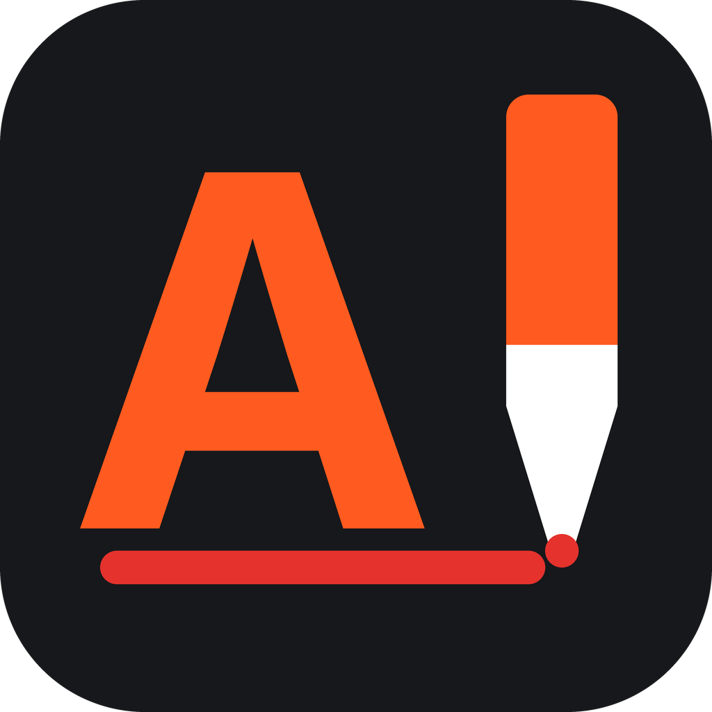
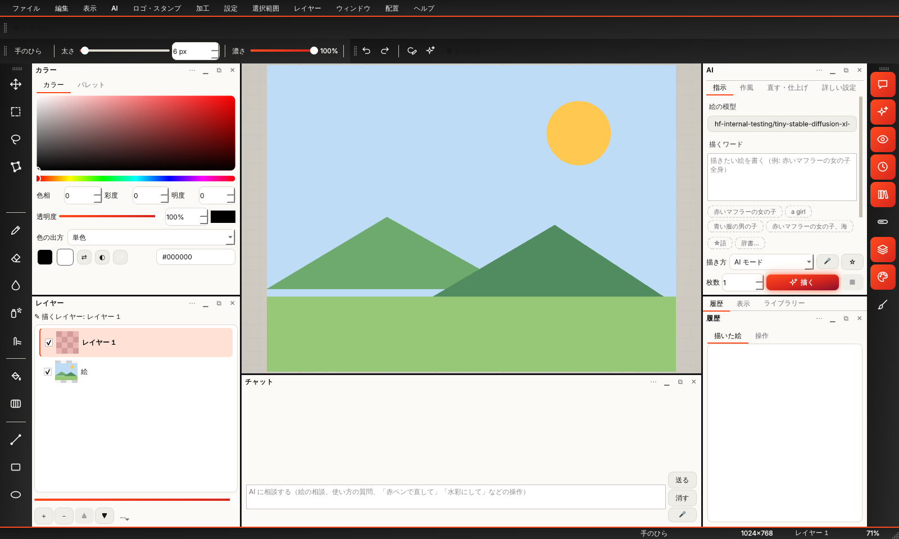
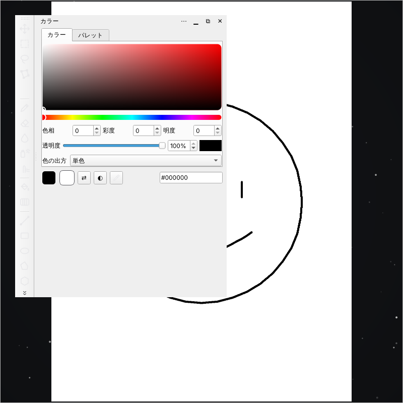

<p align="center">
  
  <br>
  
</p>

# AtelIer

人が使う、AI が使う、AI を使うペイントソフトです。読み方は「アトリエ」で、名前の中の A と I が AI を表します。

[](.github/workflows/atelier-e2e.yml)
[](pyproject.toml)
[](pyproject.toml)
[](packaging/installer.nsi)
[](LICENSE)



## 目次

- [できること](#できること) / [クイックスタート](#クイックスタート) / [インストール](#インストール) / [動作環境](#動作環境) / [使い方](#使い方) / [設定](#設定) / [開発](#開発) / [ライセンス](#ライセンス)

## できること

- 人が描く: ブラシと筆圧、消しゴム、塗りつぶし、グラデーション、図形、文字、選択範囲、レイヤー、手ぶれ補正、対称、定規で、ふつうのペイントソフトとして描けます。
- 精度優先で AI に描かせる: 構図・線画・塗り・仕上げのように人の描き方の工程に分けて描き、工程ごとに検品して、崩れが残れば直してから次へ進みます。描いている間は「工程 i/N 名前」で今の工程が出ます。手早く 1 枚ほしいときは「AI モード」も選べます。
- 赤ペンで直す: 直してほしい所を赤ペンで囲むと、囲みの中だけを直します。印はレイヤーの欄に「赤ペン」として出て、隠す・消す・元に戻すができます。直した結果は一番上の新しいレイヤーに置きます。
- 加工する: 綺麗にする、拡大する、画風を替えるなどの加工を、絵全体か囲んだ所に掛けられます。
- 模型を選んで管理する: 「模型の管理」で絵の模型を取る・切り替える・消すができます。推奨は評価の点の高い順に並び、タグで好みの模型を探せます。模型は共有の置き場（`C:\LLM`）に置き、ほかのアプリと共有します。
- 液タブで描く: キャンバスだけを全画面に出し（表示 → 全画面で描く、Ctrl+Shift+F）、欄と帯は「まとめた窓」に組んで全画面の上に浮かせます。



ほかのアプリとは、拡張の登録口でつながります。

- 拡張の登録口: entry points（`atelier.extensions`）か、拡張の置き場（`C:\ProgramData\AtelIer\extensions`）に置いた拡張を起動のときに読み、メニューやモードを足します（`atelier/extensions.py`、[docs/knowledge/integration.md](docs/knowledge/integration.md)）。キャラクターデザイン（設定資料、三面図、表情差分）は、CharacterDesigner がこの口から足します。
- CharacterDesigner からの引き継ぎ: CharacterDesigner を使っていた人には、初めての起動で「CharacterDesigner から引き継ぐ」窓が出ます。引き継ぐ物（設定、模型の好み、ライブラリー、描く部品）は利用者が選び、あとから「ファイル」メニューでも開けます。黙って写すことはしません。

## クイックスタート

1. [Releases](https://github.com/Maguro-JP/AtelIer/releases) から `AtelIer-Setup.exe` を取ります。
2. `AtelIer-Setup.exe` を開いて、画面の通りに進めます。CharacterDesigner も一緒に入れたいときは、選べる項目の印を付けます（ネットから取ります）。
3. スタートメニューかデスクトップの AtelIer を開くと、アプリの窓が開きます。初めての起動では、使い方のツアーが出ます。

## インストール

Windows では、上の Setup.exe で入れます。更新するときは、新しい版の Setup.exe を開きます。
ソースから入れるときは、次の通りです。

```bash
git clone https://github.com/Maguro-JP/AtelIer.git
cd AtelIer
python3 -m venv .venv && source .venv/bin/activate   # Windows は .venv\Scripts\activate
pip install -e ".[dev]"
```

AI で描くには絵の模型が要ります。模型が無くても、人が描く機能は使えます。模型は「設定 → 模型の管理（入れ替え・更新）…」から取れます（[docs/models.md](docs/models.md)）。

## 動作環境

- 配っている Setup.exe は Windows 用です。Python と部品（PySide6、NumPy、Pillow）を同梱しています。
- AI で描くには、絵の模型を動かす部品（torch、diffusers）と、模型の大きさに見合う空き容量（1 つ約 7GB）が要ります。
- ソースから動かすときは Python 3.11 以上と PySide6 6.6 以上が要ります。Linux（画面なし）の Python 3.13 で起動と試験を確かめています。macOS の実機では確かめていません。

## 使い方

ソースから入れたときは、次のコマンドでアプリの窓を開きます。

```bash
python -m atelier
```

道具の帯のボタンにカーソルを合わせると、名前とキーが出ます。

| 操作 | キー |
|---|---|
| ペン、消しゴム | B、E |
| 塗りつぶし、スポイト | G、I |
| 四角の選択、投げなわ | M、L |
| 元に戻す、やり直す | Ctrl+Z、Ctrl+Y |
| 保存、PNG で書き出す | Ctrl+S、Ctrl+E |
| 全画面で描く | Ctrl+Shift+F |

作業ファイル（`.atelier`）はレイヤーごと保存します。PNG と PSD にも書き出せます。

## 設定

| 環境変数 | 用途 | 必須 |
|---|---|---|
| `ATELIER_HOME` | アプリの設定・部品・記録の置き場を変えます | 任意 |
| `LLM_HOME` | 模型の置き場を変えます（設定で選んだ置き場があれば、そちらが先です） | 任意 |
| `ATELIER_OUTPUT` | 描いた絵の保存先を変えます | 任意 |

## 開発

ソースからの入れ方は「インストール」の節にあります。試験と検査を流します。

```bash
python3 scripts/run_tests.py                 # 試験を、ファイルごとに別の処理で流します
python3 scripts/run_tests.py test_brushtools # 1 ファイルだけ流します
python3 -m pyflakes atelier                  # 静的な検査
python3 packaging/make_icon.py               # アプリのアイコン（16〜256 画素の .ico）を作り直します
```

模型の部品（torch、diffusers）が無い環境では、`tests/needs_models.txt` に書いたファイルを飛ばします。

重い作業は GitHub Actions で行います。`atelier-setup` が Setup.exe を組み、`atelier-e2e` が Windows で入れて起動と描くところまでを確かめてから Release を出します。描く精度は `adhere-bench`（頼んだ通りに描けたか）、`phase-bench`（工程ごとの描き方）、`qcbench`（検品）などで測ります。

構成は [docs/STRUCTURE.md](docs/STRUCTURE.md)、決めたことと理由は [docs/knowledge/decisions.md](docs/knowledge/decisions.md)、使っている部品のライセンスは [docs/third-party.md](docs/third-party.md) にあります。

## ライセンス

ソースは公開していますが、利用の許諾はしていません。詳しくは [LICENSE](LICENSE) を読んでください。依存している PySide6 は LGPL、NumPy は BSD ライセンスです。
