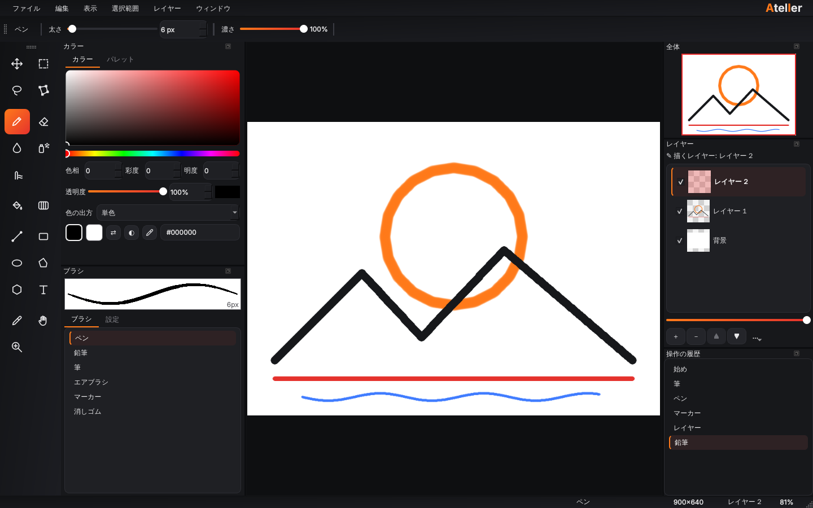

<p align="center">
  
</p>

# AtelIer

人が使う、AI が使う、AI を使うペイントソフトです。読み方は「アトリエ」。名前の中の A と I が AI を表します。



## 主な機能

- 描く: ペン・鉛筆・筆・エアブラシ・マーカー・消しゴム、ぼかし、スプレー、指先、塗りつぶし、グラデーション、直線・四角・楕円・多角形・正多角形、文字
- 描く補助: 筆圧、手ぶれ補正、対称（左右・上下・上下左右・点対称）、定規（平行線・同心円・放射・パース）、描いて止めると形を整える
- レイヤー: 足す・消す・複製・並べ替え・結合・ロック・不透明度・反転、選択範囲から新しいレイヤーを作る
- 選択範囲: 四角・投げなわ・多角形、コピー・切り取り・貼り付け・同じ位置に貼り付け
- 色: 色相・彩度・明度、16 進、色の出方（単色・虹色など）、自分のパレット、最近使った色
- ファイル: 作業ファイル（`.atelier`、レイヤーごと）、PNG と PSD の書き出し、自動保存と落ちたあとの復元
- 表示: 拡大・回転・左右反転、グリッド、全体表示、操作の履歴、7 つのテーマ

AI の機能（AI で描く・直す、AI からの操作）はこれから足します。今の状態と順番は [docs/STRUCTURE.md](docs/STRUCTURE.md) にあります。

## 動作環境

- Python 3.11 以上
- PySide6 6.6 以上、NumPy 1.26 以上
- 動作を確かめたのは Linux（画面なし）の Python 3.13 と PySide6 6.12 です。Windows と macOS の実機では確かめていません

## セットアップ手順

1. リポジトリを取得します

   ```bash
   git clone https://github.com/Maguro-JP/AtelIer.git
   cd AtelIer
   ```

2. 仮想環境を作って入ります（ほかの Python の部品と混ざらないようにするため）

   ```bash
   python3 -m venv .venv
   source .venv/bin/activate    # Windows は .venv\Scripts\activate
   ```

3. 依存を入れます

   ```bash
   pip install -e ".[dev]"
   ```

## 使い方

```bash
python -m atelier                      # 起動
python -m atelier --open drawing.atelier   # 作業ファイルか絵を開いて起動
```

| 操作 | キー |
|---|---|
| ペン / 消しゴム | B / E |
| 塗りつぶし / スポイト | G / I |
| 四角の選択 / 投げなわ | M / L |
| 手のひら / 拡大 | H / Z |
| 元に戻す / やり直す | Ctrl+Z / Ctrl+Y |
| 保存 / PNG で書き出す | Ctrl+S / Ctrl+E |
| 全体を表示 / 100% | Ctrl+0 / Ctrl+1 |

道具の帯のボタンにカーソルを合わせると、名前とキーが出ます。

## 設定

| 環境変数 | 用途 | 必須 |
|---|---|---|
| `ATELIER_HOME` | アプリのデータ（自動保存、落ちたときの記録）の置き場を変える | 任意 |

欄の配置とテーマは、閉じるときに覚えます。「ウィンドウ」→「並びを初めの形に戻す」で初めの配置に戻せます。

## ディレクトリ構成

| 場所 | 役割 |
|---|---|
| `atelier/app/` | 窓と起動。メニュー、道具の帯、開く・保存、編集の操作 |
| `atelier/paint/` | 作画の中核。キャンバス、ブラシ、描く補助 |
| `atelier/panels/` | 欄。カラー、ブラシ、レイヤー、全体表示、操作の履歴 |
| `atelier/ui/` | テーマ、アイコン、ロゴ |
| `atelier/files/` | 置き場、作業ファイル、PSD の書き出し |
| `atelier/ai/`、`atelier/agent/` | AI を使う側と、AI が使う側（これから） |
| `tests/` | 試験 |
| `docs/` | 決めたこと（[decisions.md](docs/decisions.md)）、構成（[STRUCTURE.md](docs/STRUCTURE.md)） |

## 開発者向け情報

```bash
# 試験（画面を出さずに流す）
QT_QPA_PLATFORM=offscreen python3 -m unittest discover -s tests -t .

# 静的な検査
python3 -m pyflakes atelier tests
```

作画の部品は CharacterDesigner から流用しています。どのファイルがどこへ来たかは [docs/STRUCTURE.md](docs/STRUCTURE.md) の対応表にあります。

## ライセンス

非公開（個人用）です。詳しくは [LICENSE](LICENSE)。依存している PySide6 は LGPL、NumPy は BSD ライセンスです。
