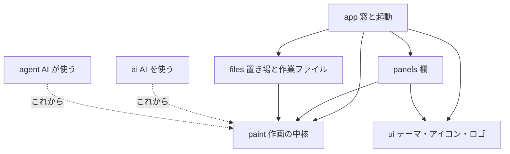

# 構成

## 3 つの柱と置き場

| 柱 | 意味 | 置き場 | 今の状態 |
|---|---|---|---|
| 人が使う | 人がペンやマウスで描く | `atelier/paint`、`atelier/panels`、`atelier/app` | 動く |
| AI が使う | AI がこのソフトを道具として操作する | `atelier/agent` | 置き場だけ。入口は `Canvas.draw_stroke`（人の筆と同じ経路で描く） |
| AI を使う | 絵の模型で描く・直す・選ぶ | `atelier/ai` | 置き場だけ |

## ディレクトリ

```
atelier/
  app/       窓と起動。メニュー、道具の帯、開く・保存、編集の操作
  paint/     作画の中核。キャンバス、ブラシ、描く補助、赤ペンの印
  panels/    欄。カラー、ブラシ、レイヤー、全体表示、操作の履歴
  ui/        見た目と操作の土台。テーマ、アイコン、ロゴ、窓の収まり、キーとホイールの守り
  files/     置き場と作業ファイル（.atelier）、PSD の書き出し
  ai/        AI を使う側（これから）
  agent/     AI が使う側（これから）
  assets/    ロゴとアイコン（SVG）
tests/       試験。窓を開き、マウスで操作して画素で確かめる
docs/        決めたこと（decisions.md）、この地図、画像
```

## 層の向き

矢印は「読む（import する）向き」。下の層は上の層を読まない。`tests/test_identity.py` が向きを見ている。



## CharacterDesigner からの対応表

流用元は `Maguro-JP/CharacterDesigner` の `chatdraw/`（2026-11-21 時点の main、コミット 4a9e809）。

| 流用元（chatdraw/） | AtelIer（atelier/） | 変えた所 |
|---|---|---|
| `canvas.py` | `paint/canvas.py` | import の先。絵を開くときに読めない絵を止める。自動選択の形の変換は `mask_path.py` を読む |
| `brush.py` | `paint/brush.py` | 無し |
| `assist.py` | `paint/drawing_assist.py` | 名前 |
| `redpen.py` | `paint/redpen.py` | 無し |
| `autosel.py` の `to_path` | `paint/mask_path.py` | この関数だけを切り出した（ほかは模型が要る） |
| `brushpreview.py` | `panels/brush_preview.py` | 名前 |
| `colorpanel.py` | `panels/color_panel.py` | 名前 |
| `layerpanel.py` | `panels/layer_panel.py` | 右クリックの「この右クリックを編集」を外した（menuedit を持ってきていない） |
| `app.py` の `Navigator` | `panels/navigator.py` | 切り出した |
| `app.py` のブラシの欄 | `panels/brush_panel.py` | 窓から切り出して 1 つの部品にした |
| `activity.py` の `show_ops` | `panels/operation_history.py` | 切り出して 1 つの部品にした |
| `themes.py` | `ui/themes.py` | 無し |
| `icons.py` | `ui/icons.py` | import の先 |
| `fit.py` | `ui/window_fit.py` | 名前 |
| `wheelguard.py` | `ui/wheel_guard.py` | 名前 |
| `typeguard.py` | `ui/type_guard.py` | 名前 |
| `app.py` の `exec_once` | `ui/popup_menu.py` | 切り出した |
| `project.py` | `files/project_file.py` | 拡張子を `.atelier` に。`.cdproj` も読める |
| `paths.py` | `files/paths.py` | アプリのデータの置き場と JSON の読み書きだけにした（模型の置き場は外した） |
| `crashlog.py` | `app/crash_log.py` | import の先 |
| `app.py` の道具の一覧 | `app/tools.py` | 赤ペンと自動選択を帯から外した |
| `app.py` の共の操作 | `app/actions.py` | AI・ごみ箱・ツアーの操作を外した |
| `app.py` の選択・貼り付け | `app/edit_commands.py` | 知らせを下の帯に出す |
| `app.py` の開く・保存・自動保存 | `app/file_commands.py` | 裏の糸を使わず、その場で書く |
| `app.py` の窓 | `app/main_window.py` | 新しく組んだ（作画の欄と帯だけ） |
| `tests/test_draw_api.py` | `tests/test_stroke_api.py` | import の先 |
| `tests/test_brushtools.py` | `tests/test_brush_tools.py` | 窓の部品の名前。コマンドとツアーの確かめを外した |
| `tests/test_shapeassist.py` | `tests/test_drawing_assist.py` | 窓の部品の名前 |
| `tests/test_layertools.py` | `tests/test_layer_tools.py` | 窓の部品の名前。キーの重なりは窓の QAction を直に数える |

## これから持ってくる物（候補）

今回は持ってきていない。上から順に、持ってくるかを 1 つずつ決める。行数は流用元の目安。

### 作画まわり（AI が要らない）

| 流用元 | 働き | 行数 | 付いてくる物 |
|---|---|---|---|
| `timelapse.py` | 描いた過程の記録と GIF・動画の書き出し | 306 | Pillow、動画は imageio-ffmpeg |
| `keys.py`、`i18n.py` | キーの割り当ての変更、英語の表示 | 434 | 無し |
| `layouts.py`、`tabdock.py` | 欄の配置の保存・読み込み・プリセット | 528 | i18n |
| `themeedit.py`、`backdrop.py` | 自分のテーマを作る、帯の模様 | 261 | 無し |
| `notice.py`、`motion.py`、`popup.py` | 右下の知らせの札、動き | 452 | 無し |
| `menuedit.py`、`ribbon.py` | メニューと帯の並べ替え、リボン | 710 | i18n、motion |
| `trash.py` | 消した絵のごみ箱 | 215 | 絵の記録の置き場（finishers の一部） |
| `workkeep.py` | 絵ごとの作業の保持、ORA の読み書き | 277 | redpenclean |
| `tour.py`、`tours.py`、`helpview.py` | 使い方ツアー、ヘルプの窓 | 417 | motion |
| `app.py` の `Reference` | 参考画像の欄 | 40 | 無し |

### AI を使う（`atelier/ai` へ）

| 流用元 | 働き | 行数 | 付いてくる物 |
|---|---|---|---|
| `engine.py`、`models.py`、`catalog.json`、`membudget.py` | 絵の模型で描く、模型の一覧、メモリの予算 | 約 3,500 | torch、diffusers。engine は約 25 のファイルを読むので、切り分けが要る |
| `autosel.py`、`facefeat.py` | 押した所の物を選ぶ（自動選択） | 436 | transformers（SAM 2）、scipy |
| `edittools.py`、`seamfix.py`、`finishers.py` | 囲んだ所だけ直す、継ぎ目、仕上げ | 約 1,900 | engine |
| `upscale.py`、`restyle.py`、`postfx.py` | 拡大、画風の変換 | 545 | engine |
| `aipanel.py`、`activity.py`、`chatpanel.py` | AI の欄、進みと履歴、チャット | 約 1,300 | 上の全部 |
| `setup.py`、`manager.py`、`fetchfile.py` | 模型の取得と管理 | 約 1,500 | huggingface_hub |

### AI が使う（`atelier/agent` へ）

| 流用元 | 働き | 行数 | 付いてくる物 |
|---|---|---|---|
| `commands.py`、`assistant.py`、`intent.py` | 言葉でアプリを操作する（操作の一覧と当てはめ） | 618 | aipanel、layouts、themes に寄っているので、作画の操作だけに切り分ける |

### 持ってこない物（キャラクターデザイン専用）

`charadesign.py`、`charafile.py`、`body.py`、`bodycheck.py`、`handcheck.py`、`mirrorcheck.py`、`origqc.py`、`omakase.py`、`director.py`、`logo.py`（ロゴ・スタンプ作り）、`batch.py`、`to3d.py`、`tools/` の検品と学習。
